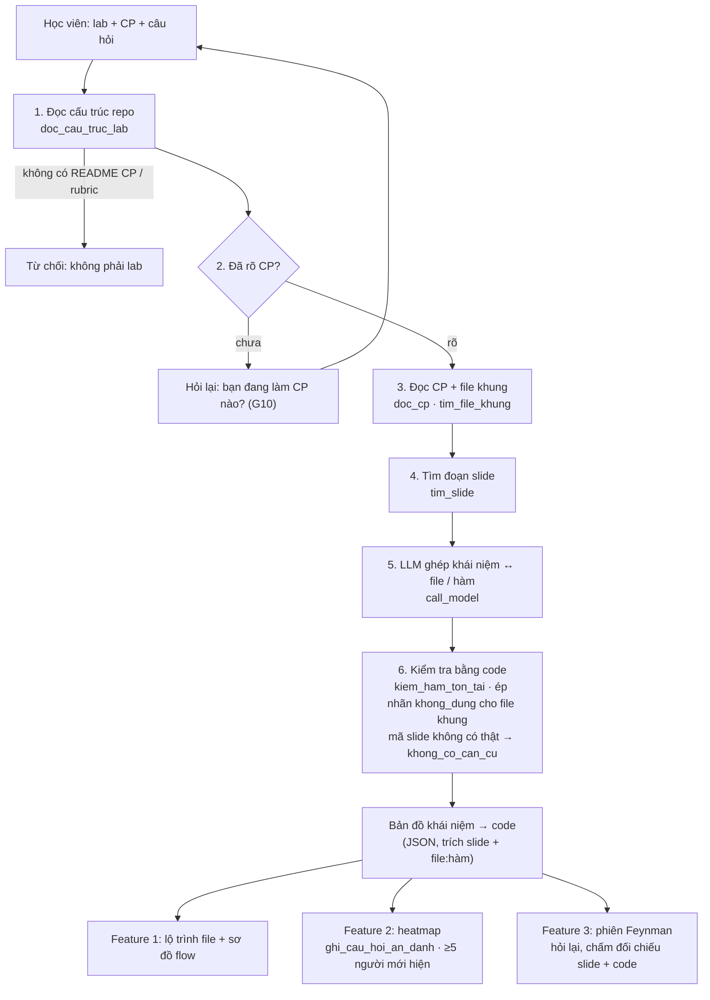

# AI SPEC — Bản đồ bài giảng ↔ code lab theo CP · Nhóm G2026 · Phòng C401 · Zone [X]

> Mốc nộp: §7 chốt chuẩn "đạt" tại **CP2 19:30 Thứ Sáu 27/11** · §0–§7 nộp **CP3 10:00 Thứ Bảy 28/11** · đủ §0–§10 **CP4 14:30 Thứ Bảy 28/11** · §10 changelog ghi tiếp đến **23:59 Thứ Bảy 28/11**.
> Đầu mỗi mục ghi bước guide (`02-guide.md` trong repo đề) chỉ cách điền. Mỗi mục ngắn, có số và nguồn; chi tiết để ở file được trỏ tới. Xoá dòng hướng dẫn trong ngoặc vuông khi điền xong.

Track: [x] A · [ ] B · [ ] C · [ ] D · [ ] E — bài toán: nhóm tự mở rộng — học viên hiểu bài lab và nối lab với bài giảng hôm trước. Lõi phân tích repo lab + slide, xác định CP luyện khái niệm nào và nằm ở file / hàm nào; 3 feature: lộ trình file theo CP · heatmap khái niệm lớp hay kẹt · phiên Feynman tự giải thích lại
Data BTC cấp đã dùng (nếu có — không commit nguyên file): sẽ dùng `data/preclass/` để kiểm lại (học viên có tự giải thích lại hay không) — chưa đếm, số sẽ ghi ở `evidence/data-mining.md`

## §0. Hiện tại việc này diễn ra thế nào *(guide 1.1)*
- Luồng hiện tại (trong khoá AI20K, theo trải nghiệm của nhóm — chưa phải bằng chứng):
    1. Buổi lý thuyết: học khái niệm qua slide (vd p99, health check, trace)
    2. Buổi lab: nhận repo (README, checkpoint, rubric, test), mentor giải thích nhiệm vụ
    3. Học viên đọc README hoặc paste repo / đề vào ChatGPT / Claude Code, sửa code cho tới khi test xanh, nộp
    4. Hiếm khi quay lại nối code với slide; bị hỏi "chỗ nào đo p99, sao không đo trung bình" thì không trả lời được
- Công cụ đang được dùng: ChatGPT, Claude Code / Cursor (hỏi đáp trên repo); DeepWiki (bóc repo thành wiki + hỏi đáp); NotebookLM (hỏi đáp trên tài liệu tự nạp); đọc lại slide; hỏi bạn / mentor. Số người dùng mỗi công cụ: chưa kiểm.

## §1. Người dùng & bằng chứng *(guide 1.1, 1.2)*
- Người dùng chính (một vai cụ thể): học viên AI20K đang làm hoặc vừa nộp lab của buổi, muốn hiểu bài chứ không chỉ cho test xanh. Không phục vụ người chỉ muốn vibe code cho qua.
- Việc họ cố làm xong: hiểu lab vừa làm luyện khái niệm nào của bài giảng hôm trước, và khái niệm đó chạy ở đâu trong code.
- Hôm nay họ giải bằng gì, hỏng ở đâu, vì sao chưa bỏ: hỏi ChatGPT / Claude, đọc lại slide, hỏi mentor. Hỏng ở chỗ công cụ chung không có slide của khoá và không biết cấu trúc đề lab, nên giải thích chung chung, không chỉ ra "khái niệm trong slide này = hàm này trong lab"; slide và code nằm hai nơi, người học phải tự nối. Chưa bỏ vì miễn phí, có sẵn, và chưa có công cụ nào gắn lab với bài giảng của khoá *(giả thuyết, chờ phỏng vấn)*.
- Pain: học viên AI20K làm lab để thực hành bài giảng hôm trước, nhưng không biết khái niệm trong bài giảng nằm ở đâu trong code của lab (CP luyện gì, ở file / hàm nào, đổi đi thì hỏng gì); hậu quả là test xanh, nộp được bài, nhưng không giải thích được code mình làm, bài giảng và lab vẫn rời nhau.
- Bằng chứng — số chính + kết luận (chi tiết: `evidence/summary.md`): CP1 mới có giả thuyết (`evidence/hypothesis.md`). Sẽ kiểm bằng phỏng vấn ≥3 học viên ngoài nhóm + khảo sát ≥20 + data preclass + hỏi 1–2 mentor, trước CP2.

## §2. Impact & quyết định chọn *(guide 1.3)*

| Hướng | Bao nhiêu người gặp | Bao nhiêu lần / tháng | Mỗi lần tốn gì | Impact / tháng | Làm kịp không | Chọn? |
|---|---|---|---|---|---|---|
| Bản đồ bài giảng ↔ code lab theo CP (lõi + 3 feature) | __ học viên AI20K *(chờ sĩ số)* | ~__ lab / tháng *(tự ước tính, chờ phỏng vấn)* | __ khái niệm / lab không giải thích được + __ phút tự nối slide với code *(chờ phỏng vấn)* | __ | Có — 1 lab + slide của buổi đó, test lấy từ lab Day1–15 thật | ✅ |
| Chỉ tìm file cần sửa theo CP (bản đầu) | __ | ~__ lab / tháng | ~__ phút mò repo | __ | Có | ❌ giúp làm nhanh nhưng không chắc giúp hiểu; giữ làm feature 1 |
| Feynman tutor đứng riêng (ôn lại lab sau khi nộp) | __ | thấp — chỉ khi sắp bị hỏi vấn đáp *(tự ước tính)* | __ | __ | Có | ❌ gộp thành feature 3 |

- **Impact / tháng** của hướng chọn = __ người × __ lần × __ phút = __ — nguồn từng thừa số: chờ phỏng vấn / khảo sát *(chưa có số, không tự điền)*
- Hướng ĐÃ LOẠI + vì sao (giữ lại, đừng xoá):
    - Track B (B1 tra cứu hướng dẫn, B2 tương tác thuốc, B3 sàng lọc tại nhà thuốc): B2 rủi ro y khoa cao; B3 khó gặp dược sĩ trong 2 ngày; nhóm không muốn làm y tế
    - Chỉ tìm file cần sửa: mục tiêu cuối của nhóm là hiểu bài, không phải làm nhanh. Giữ lại làm feature 1
    - Feynman tutor đứng riêng: không ai tự mở app để bị kiểm tra; trộn 2 bài toán (hiểu lab + kiểm tra hiểu). Giữ lại làm feature 3 dùng chung lõi
    - App cho mentor kiểm tra từng học viên: thành công cụ giám sát, trái luật Track A (lỗi cá nhân không công khai)
    - Gallery format tóm tắt repo: trùng DeepWiki / GitDiagram, phần AI mờ, khó viết chuẩn "đạt"
- Số lần / tháng của từng kiểu người dùng (dùng cho persona ở §8): chờ phỏng vấn

## §3. Giải pháp tương tự *(guide 2.1)*
- [sản phẩm / tính năng gần giống]: một điều đáng học · một điều đáng né · mình khác gì

## §4. Thiết kế *(guide 2.2, 3.2)*
- **Lát cắt MỘT CÂU:** Học viên AI20K chọn lab và CP muốn hiểu, AI quyết định CP đó luyện khái niệm bài giảng nào và khái niệm nằm ở file / hàm nào (nhãn đọc / sửa / không đụng), học viên nhận bản đồ khái niệm → code có trích slide và code.
- **Không làm:**
    - không viết hay sửa code hộ học viên, không đụng vào repo
    - không chấm điểm hay xếp hạng từng học viên; mentor chỉ thấy số gộp ẩn danh
    - không hỗ trợ repo không phải lab
    - không dùng kiến thức ngoài slide của khoá làm căn cứ
    - không chạy code tuỳ ý của lab; phần "đoán khi đổi điều kiện" của Feynman chỉ dùng kịch bản đã chạy sẵn
- **Sơ đồ:**

- **Hình dạng:** [x] workflow cố định · [ ] một agent · [ ] nhiều agent
    - Các bước luôn giống nhau: đọc repo → xác định CP → tìm slide → ghép → kiểm. AI chỉ làm bước 5. Rẻ hơn và dễ đo bằng benchmark hơn.
    - Không chọn agent vì đường đi không đổi theo input. Để AI tự chọn tool thì dễ bỏ bước kiểm ở bước 6, mà bước 6 là chỗ chặn rủi ro chính.
- **AI dựa vào đâu** (khớp `codebase/tools.py`):

  | Công cụ | Input | Output | Tác động ra ngoài? |
  |---|---|---|---|
  | `tim_repo` | mã lab (`Day14`) hoặc tên repo | đường dẫn repo trong `LABS_DIR`, rỗng nếu không có | Không |
  | `doc_cau_truc_lab` | đường dẫn repo | cây file, nội dung README / CHECKPOINTS, `la_lab` (bool) | Không |
  | `doc_cp` | repo, mã CP | đoạn mô tả CP + file có `TODO` của CP | Không |
  | `tim_file_khung` | repo | danh sách file ghi "không sửa" trong README / AGENTS | Không |
  | `tim_slide` | lab, khái niệm | đoạn slide + mã đoạn (`DayNN-s<trang>`) hoặc rỗng | Không |
  | `ma_slide_ton_tai` | lab, mã đoạn | có / không (bước 6 dùng để bắt mã slide bịa) | Không |
  | `kiem_ham_ton_tai` | repo, file, hàm | có / không | Không |
  | `ghi_cau_hoi_an_danh` | lab, CP, khái niệm | đã ghi (không lưu mã học viên) | Có: ghi dữ liệu thống kê |

- **Mức tự động:** [x] AI gợi ý, người quyết
    - AI chỉ chỉ đường và giải thích; học viên tự đọc, tự sửa code.
    - Nối sai khái niệm ↔ code thì học viên hiểu sai, khó tự phát hiện. Vì vậy mỗi liên kết phải kèm căn cứ (file:hàm + mã slide) để học viên tự kiểm.
- **Chỗ chặn rủi ro:** rủi ro lớn nhất là bịa hàm hoặc bịa nguồn, và bảo học viên sửa file khung. Bước 6 chặn bằng code, không dựa vào LLM:
    - hàm không tồn tại thì bị bỏ
    - mã slide không có thật thì đổi thành `khong_co_can_cu`
    - file trong `tim_file_khung` luôn bị ép nhãn `khong_dung`
- **Chỗ người duyệt:**
    - AI không ghi gì vào repo của học viên
    - heatmap chỉ hiện số gộp khi ≥5 người; mentor không xem được câu hỏi của từng người
    - kết quả phiên Feynman chỉ học viên thấy
- **Nguyên tắc thiết kế:**

  | Nguyên tắc | Chỗ cụ thể trên sơ đồ / trong bản chạy thử |
  |---|---|
  | G10 — thu hẹp phạm vi khi không chắc | Bước 2: chưa rõ CP thì hỏi lại một câu; bước 1: không phải lab thì từ chối |
  | G11 — giải thích vì sao | Output: mỗi khái niệm kèm đoạn slide + `file:hàm` + 1 câu lý do |
  | G1 / G2 — nói rõ làm được gì, tốt đến đâu | Bước 6: không có căn cứ thì ghi `khong_co_can_cu`; giao diện ghi rõ chỉ hỗ trợ lab có gói kiến thức (demo: Day14) |
  | G8 / G9 — dễ bỏ qua, dễ sửa | Feature 1: học viên bấm "chỗ này sai" trên từng liên kết, ghi lại để sửa gói kiến thức |

- **Phần còn giả:**
    - CP2: `python run.py` chạy với AI giả (chế độ giả của khung), chưa gọi model thật
    - gói kiến thức Day14 (slide) đang gom
    - heatmap lúc demo dùng câu hỏi thật của bạn cùng lớp; dưới 5 người thì hiện "chưa đủ dữ liệu"

## §5. Chỗ khó — 4 lớp + ≥6 kịch bản + 2 tấn công *(guide 2.3)*

| Kịch bản | Lớp (1–4) | Hành vi mong muốn (nói gì, hiện gì, cho làm gì tiếp) | Câu thử |
|---|---|---|---|
|  |  |  |  |
| *(tấn công)* |  |  |  |
| *(tấn công)* |  |  |  |

(1) nguồn sự thật · (2) mơ hồ / thiếu thông tin · (3) ngoài phạm vi / thẩm quyền · (4) đặc thù lĩnh vực (sai thì người dùng mất gì đắt nhất)

## §6. Bốn đường đi của trải nghiệm
- Mọi thứ suôn sẻ: · Không chắc (lớp 2): · Không có căn cứ (lớp 1): · Người dùng sửa:
- Bị đòi ngoài phạm vi (lớp 3): · Trường hợp đặc thù lĩnh vực (lớp 4):

## §7. Đánh giá & chuẩn "đạt" *(guide 2.4, 4.1)*
- Data card: `data/DATA_CARD.md` · bộ câu thử: `eval/benchmark.csv` — 18 câu (thuong 7 · kho 7 · tu_choi 4) · metric: `eval/metric_spec.yaml` (4 metric: tro_dung_code · khong_sua_file_khung · co_can_cu_slide · hoi_lai_va_tu_choi_dung)
- **Chuẩn "đạt"** (chốt **trước 19:30 Thứ Sáu 27/11**, giữ nguyên đến 23:59 Thứ Bảy 28/11): "Đạt khi ≥ 80% câu qua, và 100% câu tu_choi qua, và không có câu nào gắn nhãn sửa cho file khung"
    - **Câu qua:** đạt mọi metric áp cho câu đó **và** đạt cột `pass_criterion` trong `eval/benchmark.csv`
    - Cách chấm: `python eval/grade_metrics.py eval/run-N.csv` kiểm metric bằng code, phần còn lại của `pass_criterion` do người chấm
- Kết quả: lượt 1 __/__ (__%) · lượt 2 __/__ (__%) — run ID: __ / __ → chi tiết `eval/report.md`, hồ sơ `eval/README.md`

## §8. Chi phí khi dùng thật *(guide 4.2)*
- Persona + giá: `cost/personas.yaml` · lượt mô phỏng: `cost/simulate-__.csv` (__ phiên)
- Chi phí / task thành công: __ (model __) · __ (model __)
- Chi phí / tháng ở quy mô thật: thấp __ · cơ sở __ · cao __ → chi tiết `cost/cost-estimate.md`
- So với impact / người / tháng (§2): đáng làm không, vì sao:

## §9. Rủi ro & an toàn
- Dữ liệu: đã ẩn danh gì, không thu gì, không đưa gì vào model gói miễn phí:
- AI **không được** làm gì kể cả khi người dùng yêu cầu:
- Ai có thể bị hại nếu AI sai, và nhóm chặn thế nào:

## §10. Phân công & changelog
- Phân công có tên (theo chặng, chia cặp — guide "Cách chia việc"): __
- Dùng AI vào việc gì (2–3 dòng; chi tiết `docs/ai-usage.md`):
- Nhật ký thay đổi — **mọi thay đổi sau CP2 19:30 Thứ Sáu 27/11 phải có dòng ở đây**:

**CP2 → CP4** (vd thu hẹp lát cắt, hỏi thêm người dùng, lần cải tiến trước lượt 2)

| Thời điểm | Đổi gì | Vì sao (trỏ về câu thử / lỗi / bằng chứng nào) |
|---|---|---|
|  |  |  |

**Sau CP4 (đến 23:59 Thứ Bảy 28/11)** (sửa theo góp ý — không sửa chuẩn "đạt", câu thử, số bằng chứng, kết quả các lượt đã chạy)

| Thời điểm | Đổi gì | Vì sao |
|---|---|---|
|  |  |  |
